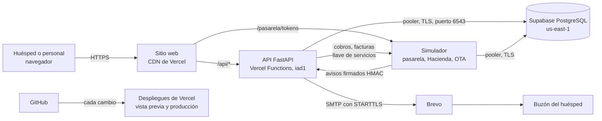
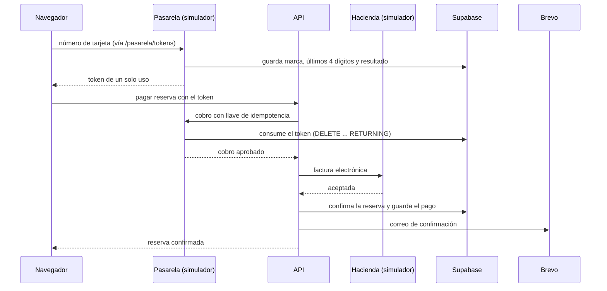

# Arquitectura en la nube del Hotel Soluna

Este documento describe cómo se desplegó el sistema del Hotel Soluna en servicios de nube pública, qué
decisiones de diseño exigió ese traslado y qué límites conserva la solución. Complementa al README, que
explica cómo ejecutar el prototipo, y a los diagramas del bloque 6.

## 1. Propósito y alcance

El problema de partida es un hotel cuyo sistema completo depende de una sola computadora de recepción, que
actúa a la vez como estación de trabajo y como servidor de la base de datos. La propuesta lo traslada a una
arquitectura híbrida: los servicios principales en la nube y un nodo local de contingencia en el hotel.

El sistema existe hoy en dos formas que comparten el mismo código:

- **Prototipo en contenedores (Docker Compose).** Reproduce en una sola máquina la infraestructura que el
  equipo administraría: Nginx con HTTPS y balanceo, tres réplicas de la API, la base de datos, el simulador
  de servicios externos y un capturador de correo. Sirve para demostrar réplicas, balanceo y aislamiento de
  redes, conceptos que en la nube quedan ocultos detrás del proveedor.
- **Despliegue en la nube (Vercel, Supabase y Brevo).** Es la versión que atendería a los huéspedes. Cada
  componente pasa a ser un servicio administrado, de modo que el hotel deja de operar servidores.

## 2. Modelo de servicio

Siguiendo la definición del NIST, cada componente se ubica en el modelo de servicio que corresponde a lo que
el proveedor administra y a lo que queda bajo responsabilidad del hotel (Mell & Grance, 2011).

| Componente | En Docker | En la nube | Modelo de servicio |
|---|---|---|---|
| Sitio web | Nginx sirve `web/` | Red de distribución de Vercel (`hotel-soluna-web`) | Plataforma (PaaS) |
| API | 3 contenedores detrás de Nginx | Funciones de Vercel en Python (`hotel-soluna`) | Funciones sin servidor (FaaS) |
| Base de datos | PostgreSQL 17 en un contenedor | PostgreSQL 17 administrado en Supabase | Base de datos como servicio |
| Pasarela, Hacienda y OTA | Contenedor con estado en memoria | Funciones de Vercel (`hotel-soluna-simulador`) con estado en Supabase | Funciones sin servidor (FaaS) |
| Correo | Mailpit (no sale de la máquina) | Brevo por SMTP con TLS | Software (SaaS) |
| Código y despliegue | Construcción local | GitHub y la integración de Vercel | Plataforma (PaaS) |

La consecuencia práctica es un cambio en la responsabilidad compartida. El sistema operativo, los parches,
los certificados, el balanceo y la capacidad pasan al proveedor. El hotel conserva la configuración, los
datos, las identidades y los secretos.

## 3. Vista general

Dentro de Supabase, los datos del hotel viven en el esquema `hotel` y los del simulador en el esquema
`simulador`. Cada uno tiene su propio usuario de base de datos y ninguno puede leer el esquema del otro.

## 4. Flujo de pago

El flujo de pago concentra la mayoría de las decisiones de seguridad del sistema:

El número de la tarjeta viaja del navegador a la pasarela y nunca llega a la API ni a la base del hotel.
Esta separación reduce el alcance de los controles exigidos para datos de tarjetas, porque el sistema del
hotel solo maneja un token sin valor fuera de la pasarela (PCI Security Standards Council, 2022).

## 5. Decisiones de diseño

**Funciones sin estado.** En Vercel cada solicitud puede atenderla una instancia distinta, y las instancias
se crean y se destruyen según la demanda. Por eso nada que deba sobrevivir a una solicitud se guarda en
memoria. El simulador, que en Docker conserva tokens y cobros en memoria, en la nube los guarda en Supabase
mediante una interfaz común (`simulador/almacen.py`). El token se consume con una sola sentencia atómica, de
modo que dos cobros simultáneos no pueden usar el mismo.

**Conexiones a la base de datos.** Cientos de instancias abriendo conexiones propias agotarían el límite de
PostgreSQL. La API y el simulador se conectan al *pooler* de Supabase en modo transacción, que reparte un
número fijo de conexiones entre todas las instancias. En ese modo la API no conserva conexiones abiertas ni
usa sentencias preparadas, que el *pooler* no admite.

**Un solo origen para el navegador.** El sitio reenvía `/api/*` a la API y `/pasarela/tokens` al simulador.
Para el navegador todo proviene del mismo dominio. Así, la política de seguridad de contenido conserva
`connect-src 'self'` y no hace falta habilitar el intercambio de recursos entre orígenes (CORS).

**Correo dentro de la solicitud.** En Docker el correo se envía después de responder al usuario. En una
función sin servidor, el trabajo posterior a la respuesta puede quedar congelado, así que en Vercel el envío
ocurre antes de responder. Si Brevo falla, el error queda registrado y la reserva no se pierde.

**Proveedores separados.** La pasarela, Hacienda y la OTA representan empresas distintas del hotel. Por eso
se despliegan en un proyecto propio, con su propio usuario de base de datos, y se comunican con la API solo
por HTTPS, con credenciales, como lo harían proveedores reales.

**Región.** La API y el simulador se ejecutan en Washington, D. C. (`iad1`), junto a la base de Supabase en
`us-east-1`. Cada consulta de la API a la base cruza una distancia corta; en las pruebas de la sección 9,
la mediana de respuesta de cada paso, medida desde fuera de la región, se mantuvo entre 230 y 310 ms.

## 6. Seguridad

| Amenaza | Control |
|---|---|
| Robo de datos de tarjeta | Tokenización en la pasarela; la base guarda solo marca y últimos cuatro dígitos |
| Cobro duplicado | Llave de idempotencia, token de un solo uso y comprobación de reserva ya pagada |
| Aviso falso de la OTA | Firma HMAC-SHA256 del cuerpo y la fecha, con tolerancia de 5 minutos (Krawczyk et al., 1997) |
| Acceso a datos ajenos | Usuarios de base de datos con privilegios mínimos por esquema; roles en la API |
| Exposición de secretos | Variables sensibles de Vercel, que nadie puede leer después de guardarlas; nada en el repositorio |
| Intercepción | TLS en todos los tramos: navegador, base de datos y SMTP, con verificación de certificado |
| Panel del simulador expuesto | `PANEL_PUBLICO=no`: panel, OTA y comprobantes exigen la llave de servicios |
| Uso del sitio para enviar correo masivo | Tope de correos de bienvenida por hora |
| Rebotes que dañan al remitente | No se escribe a dominios reservados para pruebas (Eastlake & Panitz, 1999) |
| Ataques desde el navegador | CSP, HSTS, `X-Frame-Options`, `nosniff` y política de referencia en el sitio |

## 7. Disponibilidad y puntos únicos de falla

El traslado elimina el principal punto único de falla del hotel: la computadora de recepción. En la nube:

- **Sitio:** se distribuye desde la red global de Vercel; no depende de ningún servidor del hotel.
- **API y simulador:** son funciones que el proveedor replica según la demanda; si una instancia falla, la
  siguiente solicitud la atiende otra.
- **Despliegues:** cada cambio genera primero una vista previa aislada. Producción solo cambia al fusionar
  en `main`, y una versión anterior puede restaurarse de inmediato.

Persisten, sin embargo, dependencias que conviene declarar:

- **Base de datos en una sola región.** El plan gratuito de Supabase no ofrece réplicas en otra región ni
  restauración a un punto en el tiempo. Una caída regional dejaría al sistema sin datos. La mitigación es el
  bloque 4: respaldos propios restaurables en el nodo local de contingencia.
- **Una región de cómputo.** La API se ejecuta en `iad1`. Para un hotel en Costa Rica la latencia es
  aceptable, pero una caída de esa región afectaría al servicio.
- **Dependencia de proveedores.** Vercel, Supabase y Brevo son puntos de falla externos. El código, en
  cambio, no está atado a ellos: la misma API corre en Docker con PostgreSQL y cualquier servidor SMTP.

## 8. Límites de los planes gratuitos

| Servicio | Límite relevante | Consecuencia |
|---|---|---|
| Vercel Hobby | Uso personal y no comercial; registros de ejecución por 1 hora | Una operación real requiere el plan Pro |
| Supabase Free | Pausa tras una semana sin uso; 500 MB; sin restauración a un punto en el tiempo | Reactivar antes de la exposición; respaldo propio |
| Brevo Free | 300 correos al día; reescribe remitentes de Gmail u Outlook | Suficiente para el prototipo; un dominio propio conservaría el remitente |

Los límites de solicitudes que Nginx aplica en Docker (inicio de sesión, tarjetas y suscripciones) aún no
están replicados en Vercel. La API conserva el bloqueo de cuentas tras intentos fallidos, pero un límite por
dirección IP requeriría el *firewall* de Vercel.

## 9. Verificación

La prueba `pruebas-nube/prueba_vercel.py` recorre el sistema desplegado como lo haría un huésped y comprueba
cada servicio: sitio y cabeceras, salud de la API y de la base, catálogo, reserva, pago aprobado y rechazado,
factura aceptada, pago repetido, cancelación con reembolso, protección del panel y, con la llave de
servicios, el registro en Hacienda y el aviso firmado de la OTA. Cancela al final las reservas que crea.

En su ejecución del 18 de noviembre de 2026 aprobó las 19 comprobaciones, con una mediana de 227 ms y un
máximo de 605 ms por paso. Las 64 pruebas automáticas de `api/tests` cubren, además, los casos que no
conviene provocar en producción, como la caída de la pasarela o avisos alterados.

## Referencias

Eastlake, D., 3rd, & Panitz, A. (1999). *Reserved top level DNS names* (RFC 2606). Internet Engineering
Task Force. https://doi.org/10.17487/RFC2606

Krawczyk, H., Bellare, M., & Canetti, R. (1997). *HMAC: Keyed-hashing for message authentication*
(RFC 2104). Internet Engineering Task Force. https://doi.org/10.17487/RFC2104

Mell, P., & Grance, T. (2011). *The NIST definition of cloud computing* (NIST Special Publication 800-145).
National Institute of Standards and Technology. https://doi.org/10.6028/NIST.SP.800-145

PCI Security Standards Council. (2022). *Payment Card Industry Data Security Standard: Requirements and
testing procedures* (Version 4.0). https://www.pcisecuritystandards.org
